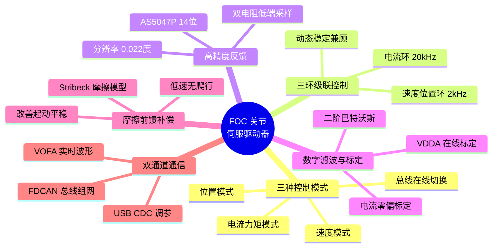
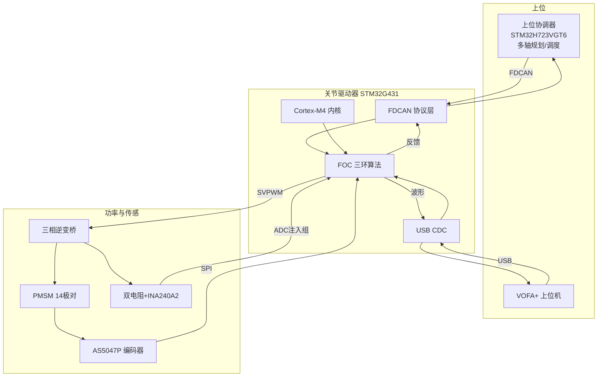
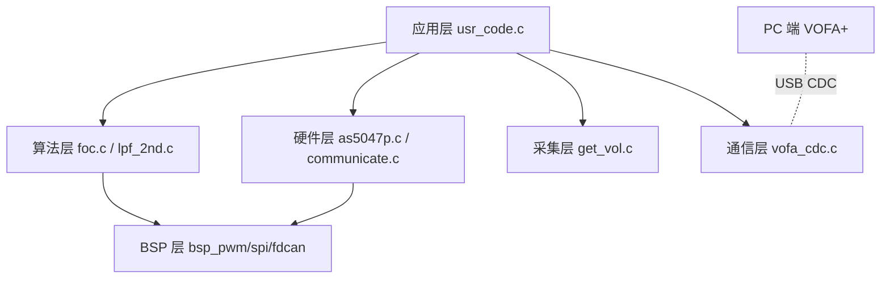
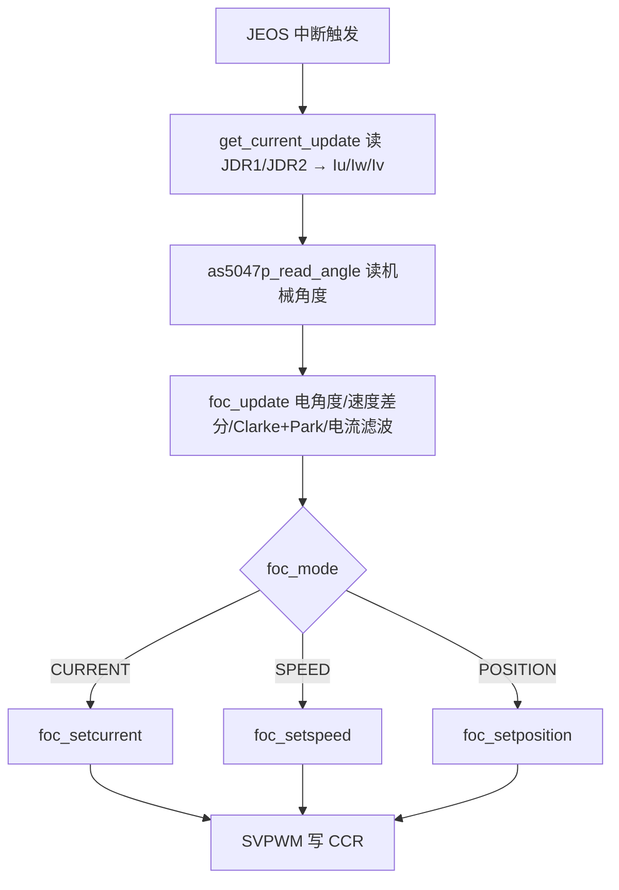
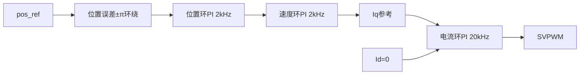

<!--
  报告模板占位说明（正式提交前请处理并删除本注释）：
  1. 【图X：…】为需插入的图片/照片/截图占位，按提示补入。
  2. 【实测填写：…】为需用仪器/VOFA+ 实测后填入的量化数据。
  3. 全文已按模板字数上限撰写（摘要≤800，1.1~1.3≤400，1.4/1.5/1.6≤200，4.1≤300，4.2≤1000）。
  4. 全文未出现任何学校、指导老师、团队真实姓名信息。
-->

# 作品名称：面向机器人关节的高动态 FOC 伺服驱动器

> —— 基于 STM32G431 的位置/速度/电流三环级联矢量控制与 FDCAN 多轴组网

---

## 摘要

本作品设计并实现了一套面向机器人关节与多轴协同机械臂的高性能 FOC（磁场定向控制）伺服驱动器。系统以 STM32G431CBU6（Cortex-M4，170 MHz，内置 FPU 与数学加速器）为主控，采用双电阻低端电流采样、AS5047P 十四位磁编码器与 SVPWM 空间矢量调制方案，构建了位置环、速度环、电流环三环级联闭环控制。其中电流环运行于 20 kHz，速度环与位置环运行于 2 kHz，实现电机的平稳起动、精确定位与快速动态响应。

为提升控制品质，作品引入二阶巴特沃斯数字滤波抑制采样噪声，配合 VDDA 与电流零偏在线标定保证测量精度；并设计基于 Stribeck 摩擦模型的转矩前馈补偿，克服静摩擦死区、改善低速平稳性。在系统集成方面，作品集成 FDCAN 工业总线，定义了使能、电流/速度/位置三模式切换与实时反馈的收发协议，天然支持多关节总线组网；同时通过 USB CDC（12 Mbps）与 VOFA+ 上位机构建实时波形观测与在线调参通道，无需重新烧录即可闭环整定。

作品紧扣工业 4.0 与碳中和背景下机器人驱动的核心需求，在控制性能、能效可靠性、集成度与创新三方面均做出针对性设计，可作为人型机器人关节、协作机械臂与精密伺服系统的核心执行单元。

---

# 第一部分　作品概述

## 1.1 功能与特性

作品是一款集成化 FOC 伺服驱动器，核心功能与特性如下：

- **三种控制模式**：支持电流（力矩）、速度、位置三种闭环模式，可通过总线实时在线切换，适应力控、调速、精确定位等任务。
- **三环级联控制**：位置环→速度环→电流环级联，电流环 20 kHz、外环 2 kHz，兼顾动态响应与稳定性。
- **高精度反馈**：AS5047P 十四位磁编码器（分辨率 0.022°）实现绝对角度闭环；双电阻低端采样精确重构三相电流。
- **数字滤波与标定**：二阶巴特沃斯滤波抑制噪声，上电自动完成电流零偏与 VDDA 标定。
- **摩擦前馈补偿**：基于 Stribeck 模型补偿静/动摩擦，改善起动平稳性。
- **双通道通信**：FDCAN 工业总线用于多轴组网部署，USB CDC + VOFA+ 用于实时波形观测与在线调参。

**图1　驱动器功能特性一览**

## 1.2 应用领域

作品面向工业 4.0 与机器人产业中对**精密驱动、高动态、可组网**有强需求的场景：

- **人型机器人关节**：作为髋、膝、踝、肩、肘等关节的执行单元，提供高精度位置/力矩控制，多关节经 CAN 总线协同。
- **协作机械臂 / 多轴机械臂**：每个驱动器对应一个可寻址轴，支持轨迹协同与实时反馈，模式在线切换适应抓取、装配、力控作业。
- **精密伺服设备**：数控机床、注塑机、激光切割等进给轴，要求高动态响应与稳态精度。
- **云台与稳定平台**：依托高分辨率位置闭环实现低速平稳与精确指向。
- **AGV / 移动机器人驱动轮**：速度模式 + 总线组网，实现多轮协调驱动。

上述场景共性为：需要转矩脉动小、定位准、可总线级联的关节化伺服单元，正是本作品的目标定位。

【图2：典型应用场景示意（人型机器人/机械臂/云台拼图）】

## 1.3 主要技术特点

1. **矢量控制解耦**：通过 Clarke/Park 变换将三相电流解耦为励磁分量 Id 与转矩分量 Iq，采用 Id=0 策略最小化定子铜损，全部电流用于产生转矩。
2. **SVPWM 空间矢量调制**：相较 SPWM，直流母线电压利用率提升约 15.5%，谐波与发热更低；实现中含扇区判断、七段式矢量合成与过调制比例钳位。
3. **20 kHz 中断驱动实时架构**：ADC 注入组由 TIM1 触发，采用 JEOS 中断确保双通道电流同步采样，中断内完成采样、解算、控制与 SVPWM 输出，控制周期 50 μs。
4. **二阶数字滤波**：双线性变换离散化的巴特沃斯 IIR 滤波器（阻尼 0.707，无过冲），电流 1500 Hz、速度 100 Hz，−40 dB/dec 滚降。
5. **在线标定**：利用芯片内部 VREFINT 反算真实 VDDA，消除供电漂移；上电多次采样求均值标定电流放大器零偏。

## 1.4 主要性能指标

| 指标 | 参数 |
|------|------|
| 主控 | STM32G431CBU6，Cortex-M4F，170 MHz |
| 电流环频率 | 20 kHz（周期 50 μs）|
| 速度/位置环频率 | 2 kHz |
| PWM | 中心对齐，20 kHz |
| 编码器 | AS5047P，14-bit，分辨率 ≈0.022° |
| 电流采样 | 双电阻低端，INA240A2（G=50），5 mΩ |
| 电流/速度滤波 | 二阶巴特沃斯 1500 Hz / 100 Hz |
| 电机极对数 | 14 |
| 通信 | FDCAN + USB CDC（12 Mbps）|
| 定位精度 / 超调 / 响应时间 | 【实测填写】 |

## 1.5 主要创新点

1. **关节化总线架构**：单驱动器即一个可寻址智能关节，基于 FDCAN 定义三模式切换与实时反馈协议，归一化编码，支持多轴组网。
2. **Stribeck 摩擦前馈**：补偿电流直接前馈至 Iq 参考，绕过积分累积，改善起动平稳与低速无爬行。
3. **同步采样机制**：JEOS 中断 + 直读 JDR 寄存器，消除注入组双通道数据竞争毛刺。
4. **免烧录在线调参**：USB CDC + VOFA+ 波形/参数双向通道，实现看波形—改参数—即时验证闭环。

## 1.6 设计流程

作品遵循「需求分析→方案设计→分模块验证→系统集成→闭环整定」的迭代流程：先明确关节伺服需求，确定硬件与控制方案；再依次完成电流采样、编码器读取、开环 SVPWM、电流环、速度环、位置环的逐级验证；最后集成 FDCAN 与上位机，借助 VOFA+ 实测整定 PI 与摩擦补偿参数，收敛系统性能。

---

# 第二部分　系统组成及功能说明

## 2.1 整体介绍

系统采用**「上位协调器 + 关节驱动器」两级架构**。上位协调器以 **STM32H723VGT6**（Cortex-M7，最高 550 MHz，高算力单核）为核心，负责多轴轨迹规划、协同调度，并经 FDCAN 向各关节驱动器下发控制目标、汇聚反馈；本作品即为其中的**关节驱动器**节点。

关节驱动器由**主控 MCU、功率驱动、传感反馈、通信接口**四大部分构成，以 20 kHz 中断为核心节拍协同工作。TIM1 产生三相互补 PWM 并触发 ADC 注入组采样 U/W 相电流；AS5047P 经 SPI 提供机械角度；FOC 算法在中断内完成坐标变换、三环控制与 SVPWM 输出；FDCAN 负责与上位协调器交换控制指令与反馈；USB CDC 承载 VOFA+ 调试数据。各模块关系如下：

**模块关系说明**：传感模块（编码器+电流采样）为控制模块提供闭环反馈；控制模块（FOC 三环）输出 SVPWM 驱动功率模块；通信模块（CAN/CDC）在控制模块与外部之间双向传递指令、反馈与调试数据，构成完整的「感知—决策—执行—交互」闭环。

## 2.2 硬件系统介绍

### 2.2.1 硬件整体介绍

硬件以 STM32G431CBU6 为核心，外围包括：三相 MOSFET 逆变桥及栅极驱动、双电阻电流采样与 INA240A2 放大、AS5047P 磁编码器、母线电压/NTC 采样、USB 接口、CAN 收发器及电源管理。整板为一体化关节驱动器形态，可与无刷电机同轴集成。

【图3：硬件系统总体框图 / 整板功能分区标注图】

### 2.2.2 机械设计介绍

作品以电控为主，机械部分主要为**驱动板与电机的同轴集成结构**：驱动 PCB 安装于电机后端，AS5047P 位于转轴中心正上方，对轴端径向充磁磁钢进行绝对角度检测；磁钢与芯片间距、同轴度直接影响测角精度，装配时需保证磁钢中心与芯片检测中心对准。

【图4：机械装配示意（电机+驱动板+磁钢同轴剖视图，CAD 截图或手绘）】
【图5：编码器磁钢安装位置局部图】

### 2.2.3 电路各模块介绍

从总体到局部，各电路模块及关键信号如下：

- **主控最小系统**：STM32G431CBU6 + HSE 晶振 + HSI48（USB）+ 供电去耦。
- **功率级**：三相半桥 MOSFET + 栅极驱动，输入母线电压，输出 U/V/W 三相至电机。
- **电流采样**：U/W 相下端 5 mΩ 采样电阻 → INA240A2（G=50，Vref=1.65 V）→ ADC1_IN3/IN4；第三相由基尔霍夫定律推算。
- **编码器接口**：SPI1（SCK/MISO/MOSI + PA15 片选）连接 AS5047P，输出机械角度。
- **母线/温度采样**：母线电压经 1:19 分压 → ADC2；NTC 分压 → ADC2，DMA 连续采集。
- **通信接口**：USB（CDC）用于调试；CAN 收发器 + FDCAN1 用于总线组网。
- **电源管理**：母线降压产生 +5 V / +3.3 V 逻辑电源与栅驱电源。

【图6：电源与主控最小系统原理图（SCH 截图）】
【图7：功率级 + 栅极驱动原理图，标注 VBUS、U/V/W、PWM_H/L】
【图8：电流采样 + INA240A2 放大电路原理图，标注采样电阻、放大输出至 ADC】
【图9：PCB 版图（正/反面），标注功率区、采样区、数字区分区】

## 2.3 软件系统介绍

### 2.3.1 软件整体介绍

软件采用分层架构：应用层（初始化与中断调度）、算法层（FOC 与滤波）、硬件驱动层（编码器/通信）、采集层（电流/电压）、BSP 层（PWM/SPI/CAN 抽象），PC 端为 VOFA+ 上位机。程序主流程为 `setup()` 完成外设与参数注册后进入 `loop()` 空转，全部实时控制在 **ADC JEOS 中断（20 kHz）** 与 **TIM6 中断（1 ms 反馈）** 中完成。

【图10：VOFA+ 上位机实时波形与调参界面截图】

### 2.3.2 软件各模块介绍

**（1）实时控制主流程（ADC JEOS 中断，20 kHz）**
输入：三相电流原始值、编码器角度；输出：三相 SVPWM 占空比。

**（2）foc_update（传感数据更新）**
输入：`raw_angle, Iu, Iv, Iw`；输出：`elec_theta, speed, Idq`。流程：电角度 = 机械角×极对数−偏置 → 角度差分求速度并二阶滤波 → Clarke/Park 得 Id/Iq → dq 电流二阶滤波。

**（3）foc_setposition（三环级联）**
输入：目标角度 `pos_ref`；输出：`Udq` → SVPWM。位置环/速度环每 10 周期（2 kHz）执行，电流环每周期（20 kHz）执行；位置误差做 ±π 环绕取最短路径。

**（4）foc_setsvpwm（空间矢量调制）**
输入：`Uα, Uβ`；输出：`CCR1/2/3`。流程：扇区判断 → 计算 T1/T2/T0 → 过调制比例钳位 → 按扇区映射写定时器比较寄存器。

**（5）communicate（FDCAN 协议）**
`communicate_rx_callback` 解析指令（0x01 使能 / 0x02 失能 / 0x03 电流 / 0x04 速度 / 0x05 位置）与 int16 归一化参数并写入控制目标；`communicate_build_feedback` 打包使能状态、Iq、转速、角度为 8 字节反馈帧。

**（6）vofa_cdc（上位机通信）**
`vofa_cdc_send` 按 JustFloat 协议（4 B NaN 帧尾 + N×float）在 TIM6 回调发送波形；`vofa_cdc_receive` 解析 7 字节帧写入 `rx_bind` 绑定的变量，实现在线调参。

---

# 第三部分　完成情况及性能参数

## 3.1 整体介绍

作品已完成硬件制板、固件开发与联机调试，实现位置/速度/电流三模式闭环运行、FDCAN 通信与 VOFA+ 在线调参。

【图11：系统实物正面全局照片】
【图12：系统实物斜 45° 全局照片（含电机、驱动板、连线）】

## 3.2 工程成果

### 3.2.1 机械成果

【图13：驱动板与电机同轴装配实物照片】
【图14：编码器磁钢安装实物近摄】

### 3.2.2 电路成果

【图15：驱动器 PCB 实物（正面，标注主控/功率/采样区）】
【图16：驱动器 PCB 实物（反面）】

### 3.2.3 软件成果

【图17：VOFA+ 实时多通道波形界面（Id/Iq/speed/角度）】
【图18：VOFA+ 在线调参界面（下发 PI 参数/目标值）】

## 3.3 特性成果

逐项展示功能与量化性能（建议配示波器/VOFA+ 实测截图）：

| 特性 | 验证方法 | 结果 |
|------|---------|------|
| 电流环跟踪 | Iq 阶跃，观察参考 vs 实际 | 【实测填写：上升时间/稳态误差】 |
| 速度控制 | 速度阶跃 + 稳态 | 【实测填写：响应时间/稳态波动】 |
| 位置控制 | 位置阶跃 + 重复定位 | 【实测填写：超调/稳态误差/重复精度】 |
| 起动平稳性 | 开/关摩擦前馈对比 | 【实测填写：起动时间/低速波动对比】 |
| SVPWM 波形 | 观察相电流正弦度 | 【实测填写：THD/波形截图】 |
| 总线通信 | CAN 收发指令与反馈 | 【实测填写：往返时延/帧率】 |
| 温升/能效 | 满载运行 NTC + 母线电流 | 【实测填写：温升/输入功率/效率】 |

【图19：电流环阶跃响应波形】【图20：位置阶跃响应波形】【图21：相电流正弦波形】
【图22：开/关摩擦前馈起动对比波形】

---

# 第四部分　总结

## 4.1 可扩展之处

- **CORDIC 硬件加速**：以 STM32G4 内置 CORDIC 替代 CMSIS-DSP 三角函数，进一步压缩中断耗时、提升控制余量。
- **硬件级保护**：接入 TIM1 刹车输入（BRK）与片内比较器，实现过流纳秒级封波，完善过压/过温保护逻辑。
- **无感控制**：增加滑模/龙伯格观测器，实现去编码器方案以降本增可靠性。
- **振动抑制**：引入陷波滤波器抑制机械谐振，提升高刚度定位品质。
- **无线运维**：集成 STM32WB0 实现远程调参、状态监控与 OTA 固件升级，贴合工业 4.0 智能化运维需求。

## 4.2 心得体会

本作品从零构建了一套机器人关节 FOC 伺服驱动系统，过程中对「电机控制是软硬件与算法深度耦合的系统工程」有了深刻体会。

研发初期，我们并未急于闭环，而是遵循「先看得准，再控得住」的原则，逐级验证：先用示波器与 VOFA+ 确认电流采样、母线电压、编码器角度的正确性，再做开环 SVPWM 观察相电流正弦度，最后自内向外依次闭合电流环、速度环、位置环。这种分层验证的方法让每一个 bug 都能被定位在最小范围内，避免了「多处错误叠加、无从下手」的困境。

调试中最具代表性的问题是 ADC 注入组的数据竞争：定时器触发采样后，若在第一路转换完成（JEOC）就进入中断，第二路仍在转换，读到的是半更新的寄存器值，表现为电流曲线上的偶发毛刺。我们通过改用 JEOS 中断（两路全部完成才响应）并直接读取 JDR 寄存器，彻底消除了毛刺。这让我们意识到，实时系统中「时序」与「数据一致性」同样重要，HAL 库的便利有时会掩盖底层时序细节，必要时必须下沉到寄存器层面理解硬件行为。

通信环节同样收获良多：最初用 UART 高速回传波形导致严重丢帧，分析后发现是波特率带宽不足与发送周期冲突所致，改用 USB CDC（12 Mbps）后问题迎刃而解。由此我们搭建了「看波形—改参数—即时验证」的在线调参闭环，PI 与摩擦补偿参数的整定效率大幅提升。这让我们体会到，一套好的调试基础设施，其价值不亚于算法本身。

在控制品质打磨上，我们针对低速起动的静摩擦死区设计了基于 Stribeck 模型的转矩前馈，直观地改善了起动平稳性，也加深了对「前馈补偿快、反馈校正准，二者结合」这一控制思想的理解。

回顾整个过程，我们不仅掌握了 FOC 从坐标变换、SVPWM 到三环级联的完整链路，更重要的是建立了系统工程的思维方式：面对复杂系统，先分解、后集成，用数据说话、用工具提效。这些经验将是我们今后工程实践中最宝贵的财富。

---

# 第五部分　参考文献

[1] 袁雷, 胡冰新, 魏克银, 等. 现代永磁同步电机控制原理及MATLAB仿真[M]. 北京: 北京航空航天大学出版社, 2016.

[2] 王成元, 夏加宽, 孙宜标. 电机现代控制技术[M]. 2版. 北京: 机械工业出版社, 2014.

[3] 陈伯时. 电力拖动自动控制系统——运动控制系统[M]. 4版. 北京: 机械工业出版社, 2012.

[4] 张崇巍, 张兴. PWM整流器及其控制[M]. 北京: 机械工业出版社, 2012.

[5] BOSE B K. Modern Power Electronics and AC Drives[M]. Upper Saddle River: Prentice Hall, 2002.

[6] HOLMES D G, LIPO T A. Pulse Width Modulation for Power Converters: Principles and Practice[M]. Piscataway: IEEE Press, 2003.

[7] ARMSTRONG-HÉLOUVRY B, DUPONT P, DE WIT C C. A survey of models, analysis tools and compensation methods for the control of machines with friction[J]. Automatica, 1994, 30(7): 1083-1138.

[8] STMicroelectronics. RM0440 STM32G4 Series Advanced Arm-based 32-bit MCUs Reference Manual[Z]. 2023.

[9] STMicroelectronics. DS12589 STM32G431xB Datasheet[Z]. 2022.

[10] STMicroelectronics. UM2392 STM32 Motor Control SDK v5.x User Manual[Z].

[11] ams AG. AS5047P High-Resolution Rotary Position Sensor Datasheet[Z]. 2018.

[12] Texas Instruments. INA240 High- and Low-Side Bidirectional Zero-Drift Current-Sense Amplifier Datasheet (SBOS730)[Z]. 2017.

[13] Robert Bosch GmbH. CAN with Flexible Data-Rate (CAN FD) Specification Version 1.0[Z]. 2012.

[14] Arm Ltd. CMSIS-DSP Software Library Reference[Z].

[15] 刘和平, 邓力. 永磁同步电机矢量控制系统的空间电压矢量脉宽调制研究[J]. 电工技术学报. 【请按实际引用补全卷期页】
