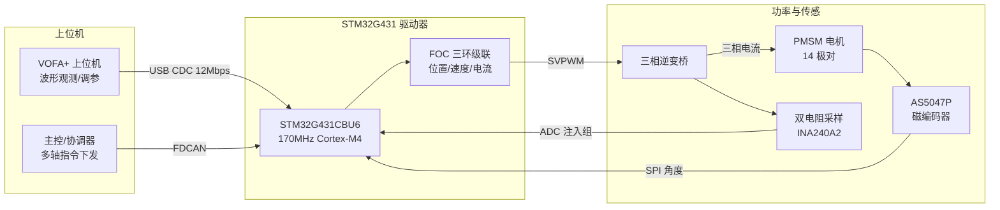
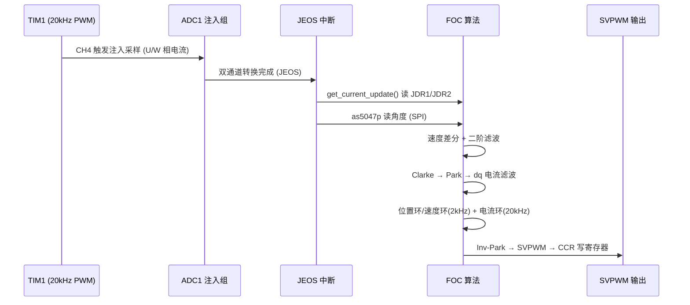
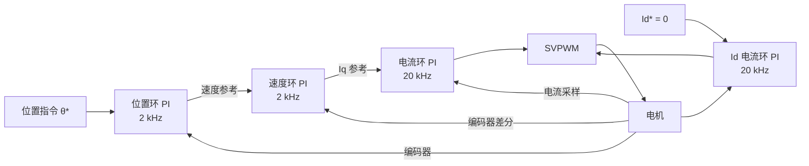
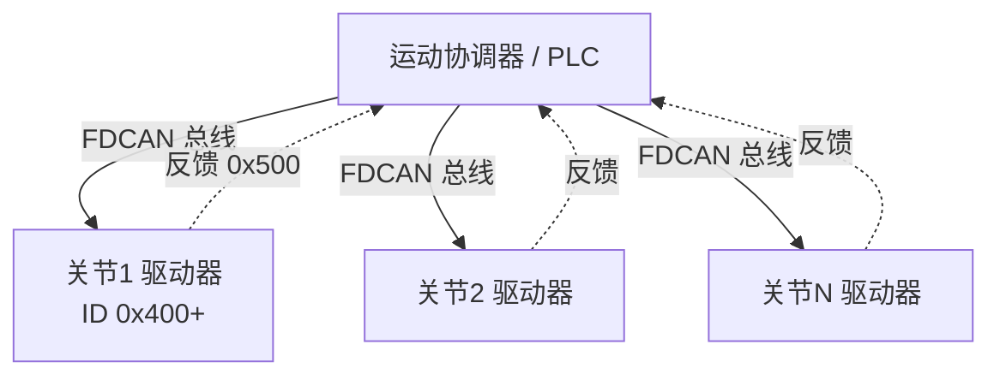

# 基于 STM32G431 的机器人关节 FOC 伺服驱动器

> **意法半导体 STM32 竞赛 · 选题四：工业 4.0 / 电机控制 / 机器人**
> 应用方向：精密驱动与机器人 —— 人型机器人关节 / 多轴协同机械臂

---

## 摘要

本作品设计并实现了一套面向**机器人关节 / 多轴协同**场景的高性能 FOC（磁场定向控制）伺服驱动器。以 STM32G431CBU6（Cortex-M4，170 MHz，内置数学加速器与先进定时器）为主控，采用**双电阻低端电流采样 + AS5047P 磁编码器 + SVPWM 调制**方案，构建了**位置环 / 速度环 / 电流环三环级联**闭环控制系统：

- **电流环 20 kHz**、**速度环 / 位置环 2 kHz**，实现电机的平稳起动、精确定位与快速动态响应；
- 采用**二阶巴特沃斯 IIR 数字滤波**抑制采样噪声，配合 **VDDA / 电流零偏在线标定**保证测量精度；
- 集成 **FDCAN 工业总线**，实现使能/失能、电流/速度/位置三种控制模式的远程切换与实时反馈，天然支持**多关节协同组网**；
- 通过 **USB CDC（12 Mbps）**实现上位机 VOFA+ 实时波形观测与在线调参。

作品对应赛题三大评审指标：**控制性能**（三环级联 + 高频电流环 + 精密位置定位）、**能效与可靠性**（SVPWM 高母线利用率 + Id=0 最小铜损 + 母线/温度监测 + 过调制钳位）、**集成度与创新**（FDCAN 工业总线组网 + 关节化伺服架构）。

---

## 目录

1. [选题背景与意义](#1-选题背景与意义)
2. [系统总体方案](#2-系统总体方案)
3. [硬件设计](#3-硬件设计)
4. [FOC 控制算法](#4-foc-控制算法)
5. [三环级联控制系统](#5-三环级联控制系统)
6. [信号采集与滤波](#6-信号采集与滤波)
7. [评审指标一：控制性能](#7-评审指标一控制性能)
8. [评审指标二：能效与可靠性](#8-评审指标二能效与可靠性)
9. [评审指标三：集成度与创新（FDCAN 总线）](#9-评审指标三集成度与创新fdcan-总线)
10. [上位机调试与在线调参（VOFA+ / USB CDC）](#10-上位机调试与在线调参vofa--usb-cdc)
11. [关键工程问题与调试记录](#11-关键工程问题与调试记录)
12. [应用场景](#12-应用场景)
13. [总结与展望](#13-总结与展望)
14. [附录：PPT 讲解大纲](#14-附录ppt-讲解大纲)

---

## 1. 选题背景与意义

在**工业 4.0 与碳中和**背景下，电机控制正从"转起来"向**高效率、高动态响应、智能化协同**演进。其中，**人型机器人关节**与**多轴协同机械臂**对驱动器提出了苛刻要求：

| 需求 | 传统方案痛点 | 本作品应对 |
|------|-------------|-----------|
| 精确力矩/位置控制 | 有刷电机、步进电机精度低、发热大 | FOC 矢量控制 + 14 位磁编码器闭环 |
| 起动平稳、低速无爬行 | 开环/六步换相有转矩脉动 | SVPWM + 三环级联 + 数字滤波 |
| 快速动态响应 | 采样/控制频率低 | 20 kHz 电流环，50 μs 控制周期 |
| 多关节协同组网 | 布线复杂、通信实时性差 | FDCAN 工业总线，标准化收发协议 |
| 便携调试与部署 | 依赖专用调试器 | USB CDC + VOFA+ 在线波形/调参 |

本作品即为满足上述需求而设计的**关节化 FOC 伺服驱动器**，可作为人型机器人关节、协作机械臂、精密伺服的核心执行单元。

---

## 2. 系统总体方案

### 2.1 系统架构



### 2.2 控制数据流（20 kHz 中断驱动）



### 2.3 软件模块划分

| 层次 | 模块 | 职责 |
|------|------|------|
| 应用层 | `usr_code.c` | setup/loop、中断回调、模式调度 |
| 算法层 | `foc.c` | Clarke/Park/SVPWM、三环 PID、坐标变换 |
| 算法层 | `lpf_2nd.c` | 二阶巴特沃斯 IIR 数字滤波器 |
| 硬件层 | `as5047p.c` | 磁编码器 SPI 驱动（16 位帧 + 偶校验）|
| 硬件层 | `communicate.c` | FDCAN 收发协议（指令解析 + 反馈打包）|
| 采集层 | `get_vol.c` | 电流采样/零偏标定、母线电压、VDDA 标定 |
| 通信层 | `vofa_cdc.c` | USB CDC 上位机波形/调参 |
| BSP 层 | `bsp_pwm/spi/fdcan…` | 硬件抽象，屏蔽 HAL 细节 |

---

## 3. 硬件设计

### 3.1 主控与外设资源分配

| 资源 | 用途 | 关键参数 |
|------|------|---------|
| STM32G431CBU6 | 主控 MCU | Cortex-M4F，170 MHz，FPU + CORDIC/FMAC |
| TIM1 CH1/2/3 | 三相 PWM（互补）| 中心对齐，ARR=4249，**20 kHz** |
| TIM1 CH4 | ADC 注入触发源 | CCR=4239，下降沿，每周期 1 次 |
| ADC1 IN3/IN4 (PA2/PA3) | U/W 相电流（注入组）| 12-bit，双通道扫描，JEOS 触发 |
| ADC1 VREFINT | VDDA 在线标定 | 启动单次 polling |
| ADC2 IN3/IN4 (PA6/PA7) | 母线电压 / NTC 温度 | 连续 DMA |
| SPI1 | AS5047P 磁编码器 | PA15=CS，14-bit 分辨率 |
| FDCAN1 | 工业总线通信 | 多轴协同 / 远程控制 |
| USB CDC | VOFA+ 上位机 | Full Speed 12 Mbps |
| TIM6 | 1 ms 反馈定时 | 波形发送 + CAN 反馈 |

### 3.2 电流采样链路

```
三相桥低端 → 采样电阻 (5 mΩ) → INA240A2 (增益 50 V/V, Vref=1.65V)
→ ADC1_IN3/IN4 注入组双通道 → JEOS 中断
→ I = (ADC/4095 · VDDA − VDDA/2) / (50 · 0.005) − 零偏
→ Iv = −(Iu + Iw)   （基尔霍夫电流定律，省一路采样）
```

- **双电阻低端采样**：仅采 U/W 两相，第三相由 KCL 推算，节省一个 ADC 通道与采样电阻；
- **INA240A2**：专用电流检测放大器，共模抑制强，适应 PWM 高共模干扰；
- **VDDA 在线标定**：利用芯片内部 VREFINT 校准值反算真实 VDDA，消除供电波动对电流换算的影响。

### 3.3 时钟方案

```
HSE 外部晶振 + HSI48(USB) → PLL(/3 ×85 ÷2) → SYSCLK = 170 MHz
ADC 时钟 = SYSCLK/4 = 42.5 MHz，采样时间 6.5 cycle
```

---

## 4. FOC 控制算法

FOC（Field-Oriented Control，磁场定向控制）将三相电流解耦为**励磁分量 Id** 与**转矩分量 Iq**，实现类似直流电机的解耦控制。

### 4.1 坐标变换


**Clarke 变换**（等幅值，`foc.c`）：

$$\alpha = u,\qquad \beta = \frac{u + 2v}{\sqrt{3}}$$

**Park 变换**：

$$\begin{aligned} d &= \alpha\cos\theta_e + \beta\sin\theta_e \\ q &= -\alpha\sin\theta_e + \beta\cos\theta_e \end{aligned}$$

其中电角度 $\theta_e = \theta_{mech}\cdot p - \theta_{offset}$，$p=14$ 为极对数。三角函数由 **CMSIS-DSP**（`arm_sin_f32/arm_cos_f32`）加速计算。

### 4.2 SVPWM 空间矢量调制

相比 SPWM，SVPWM 母线电压利用率提升约 **15.5%**（线性区可达 $V_{dc}/\sqrt3$），谐波更低、发热更小。实现流程：

1. **扇区判断**：由 $U_\alpha,U_\beta$ 计算 $A,B,C$ 三个判据 → 定位 1~6 扇区；
2. **矢量作用时间**：计算 $T_1,T_2,T_0$（七段式）；
3. **过调制钳位**：当 $T_1+T_2>ARR$ 时按比例缩放，保持电压矢量方向不失真；
4. **CCR 直写**：按扇区映射到 `CCR1/2/3` 寄存器（U→CH3, V→CH2, W→CH1）。

> 电压限幅 $U_{limit} = V_{dc}\times0.577 \approx V_{dc}/\sqrt3$，保证工作在线性调制区。

---

## 5. 三环级联控制系统

作品实现**位置环 → 速度环 → 电流环**三环级联，每一环的输出作为内环的参考值。这是机器人关节伺服的标准架构。



### 5.1 频率分配（降采样）

| 环路 | 频率 | 周期 | 实现方式 |
|------|------|------|---------|
| 电流环 (Id/Iq) | **20 kHz** | 50 μs | 每个 FOC 周期 |
| 速度环 | **2 kHz** | 500 μs | 每 10 个 FOC 周期 (`cnt % 10`) |
| 位置环 | **2 kHz** | 500 μs | 每 10 个 FOC 周期 |

内环高频保证电流跟踪快、抑制脉动；外环适当降频保证信噪比与稳定性。

### 5.2 三种控制模式

| 模式 | API | 说明 |
|------|-----|------|
| 电流/力矩模式 | `foc_setcurrent(Id, Iq)` | 直接控制转矩，用于力控 |
| 速度模式 | `foc_setspeed(ω*, Id)` | 速度环 → 电流环 |
| **位置模式（默认）** | `foc_setposition(θ*, Id)` | 位置 → 速度 → 电流三环，含角度环绕处理 |

位置环内做了 **±π 角度环绕（wrap）**处理，保证跨越 0/2π 边界时走最短路径，避免"绕圈"。

### 5.3 PI 控制器参数

| 控制器 | Kp | Ki | 输出限幅 | 积分限幅 |
|--------|-----|-----|---------|---------|
| Id 电流环 | 9.6 | 0.35 | ±7 V | ±100 |
| Iq 电流环 | 11.2 | 0.35 | ±7 V | ±100 |
| 速度环 | 0.045 | 0.00015 | ±3 A | ±1000 |
| 位置环 | 60 | 0.0001 | ±30 | ±100 |

所有 PI 控制器均带**积分限幅（抗积分饱和）**与**输出限幅**，保证饱和后快速退饱和、不超调失控。

### 5.4 转矩前馈摩擦补偿（可选增强）

纯 PI 控制在**低速与起动**时存在固有短板：电机需先建立起足够的积分误差才能克服**静摩擦（stiction）**，这会导致起动**死区、迟滞与低速爬行（crawl）**。为此，作品实现了一套**基于 Stribeck 摩擦模型的转矩前馈**，将摩擦补偿电流**直接叠加到 Iq 参考**上，绕过积分器的缓慢累积过程。

**摩擦模型**：静摩擦在零速附近最大，一旦运动起来即降为较小的动（库仑）摩擦——据此对补偿量随速度线性衰减，并设动摩擦下限：

$$I_{ff} = \operatorname{sign}(\omega^{*}) \cdot
\begin{cases}
C_s & |\omega| \le \omega_{th} \quad(\text{静摩擦区，给满补偿}) \\[4pt]
\max\!\big(C_s - (|\omega|-\omega_{th})\cdot k,\; C_d\big) & |\omega| > \omega_{th} \quad(\text{运动区，衰减到下限})
\end{cases}$$

最终转矩电流参考：$I_{q}^{*} = \text{speed\_pid.out} + I_{ff}$。补偿方向由**速度指令符号**决定，保证补偿始终"助推"目标运动方向。

**参数（实测标定值）**：

| 参数 | 符号 | 值 | 说明 |
|------|------|-----|------|
| 静摩擦补偿 | $C_s$ | 0.073 A | 零速附近克服静摩擦所需电流 |
| 静摩擦阈值 | $\omega_{th}$ | 0.1 rad/s | 静→动摩擦切换速度 |
| 摩擦斜率 | $k$ | 0.015 | 补偿随速度衰减斜率（Stribeck 效应）|
| 动摩擦下限 | $C_d$ | 0.016 A | 运动区最小补偿（库仑摩擦）|

**效果**：显著改善**起动平稳性**（直接对应评审指标一）、消除低速爬行、缩短小信号响应迟滞。该模块以独立接口 `foc_settorquefeedforward()` 提供，可按需启用/关闭，是纯 PI 架构之上的性能增强项。

> 📌 建议 PPT 用**同一起动指令下"开/关前馈"的转速与 Iq 对比波形**展示效果——起动更快、低速更平滑，是很直观的加分点。

---

## 6. 信号采集与滤波

### 6.1 二阶巴特沃斯数字滤波器

采用**双线性变换**离散化的二阶 IIR 低通滤波器（`lpf_2nd.c`），阻尼系数 0.707（巴特沃斯，无过冲）：

$$H(z) = \frac{b_0 + b_1 z^{-1} + b_2 z^{-2}}{1 - a_1 z^{-1} - a_2 z^{-2}}$$

| 信号 | 截止频率 Fc | 作用 |
|------|-----------|------|
| Id / Iq 电流 | 1500 Hz | 抑制 PWM 开关噪声，保留电流环带宽 |
| 速度 | 100 Hz | 平滑编码器差分噪声 |

相比一阶滤波，二阶滤波在同等截止频率下**滚降更陡（−40 dB/dec）**，噪声抑制更好且群延迟可控。

### 6.2 速度估计

- 基于 AS5047P 角度**差分**：$\omega = \Delta\theta / \Delta t$，$\Delta t = 50\,\mu s$；
- 自动处理 ±π 角度翻转；
- 经 100 Hz 二阶滤波平滑后送入速度环。

### 6.3 编码器精度

| 指标 | 数值 |
|------|------|
| AS5047P 分辨率 | 14-bit（16384 CPR）|
| 角度分辨率 | 360°/16384 ≈ **0.022°** (3.8×10⁻⁴ rad) |
| 接口 | SPI，16 位帧 + 偶校验 |

---

## 7. 评审指标一：控制性能

> **起动平稳性、转速/位置控制精度、动态响应速度**

| 能力 | 技术支撑 |
|------|---------|
| **起动平稳** | SVPWM 正弦调制 + Id=0 矢量控制，无六步换相转矩脉动；**转矩前馈摩擦补偿**（§5.4）克服静摩擦死区 |
| **低速无爬行** | Stribeck 摩擦前馈 + 二阶滤波降噪 + 高分辨率反馈 |
| **位置精度** | 14 位编码器（0.022°）+ 位置环 + 角度 wrap 最短路径 |
| **动态响应** | 20 kHz 电流环（50 μs），电流跟踪快，转矩响应迅速 |
| **抗扰动** | 三环级联，外环抑制负载扰动，内环抑制电气扰动 |

> 📌 **建议在报告/PPT 中补充实测曲线**（VOFA+ 导出）：
> - 位置阶跃响应（上升时间 / 超调 / 稳态误差）
> - 速度阶跃响应（响应时间 / 稳态波动）
> - Iq 电流跟踪波形（参考 vs 实际）
> - 低速正弦跟踪 / 定位重复精度

---

## 8. 评审指标二：能效与可靠性

> **功率损耗优化、完善的硬件保护机制**

### 8.1 能效优化

| 措施 | 效果 |
|------|------|
| **SVPWM 调制** | 母线利用率较 SPWM 提升 ~15.5%，同功率下电流更小、铜损更低 |
| **Id = 0 控制** | 表贴式 PMSM 下最小化定子铜损，全部电流用于产生转矩 |
| **过调制钳位** | 电压矢量按比例缩放，避免饱和失真与无效功率损耗 |
| **高频电流环** | 电流纹波小 → 谐波损耗与发热降低 |

### 8.2 可靠性与保护

| 措施 | 实现 |
|------|------|
| **母线电压监测** | ADC2 DMA 实时采集 VBUS（分压比 1:19），可扩展欠压/过压保护 |
| **温度监测** | NTC 电压采集，可扩展过温降额/停机 |
| **电流限幅** | Iq 参考限幅 ±3 A，电压输出限幅 ±7 V |
| **积分抗饱和** | 所有 PI 环积分限幅，防止饱和失控 |
| **VDDA 在线标定** | VREFINT 校准，消除供电漂移导致的电流测量误差 |
| **电流零偏标定** | 上电 100 次采样求均值，消除放大器失调 |

> 📌 STM32G4 内置**模拟看门狗 / 比较器 / TIM 刹车输入（BRK）**，可进一步接入过流硬件保护 → 已作为可靠性增强方向预留。

---

## 9. 评审指标三：集成度与创新（FDCAN 总线）

> **结合工业总线协议，解决实际生产中的连接痛点**

作品集成 **FDCAN 工业总线**，实现驱动器的标准化远程控制与实时反馈，是**多关节协同**的通信基础。

### 9.1 CAN 通信协议

**接收（主机 → 驱动器，ID = 0x400）**：单字节指令 + 16 位参数

| 指令 | 功能 | 参数编码 |
|------|------|---------|
| 0x01 / 0x02 | 使能 / 失能 | — |
| 0x03 | 切电流模式 + 设定 Iq | int16 → ±10 A |
| 0x04 | 切速度模式 + 设定转速 | int16 → ±1000 rpm |
| 0x05 | 切位置模式 + 设定角度 | uint16 → 0~2π |

**反馈（驱动器 → 主机，ID = 0x500，1 ms 周期）**：

| 字节 | 内容 |
|------|------|
| 0 | 使能状态 |
| 2-3 | Iq 电流（归一化 int16）|
| 4-5 | 转速 rpm（归一化 int16）|
| 6-7 | 机械角度（归一化 uint16）|

### 9.2 创新点

- **关节化伺服架构**：单个驱动器 = 一个可寻址的智能关节，CAN ID 区分轴号，天然支持机械臂/人型机器人**多轴总线组网**；
- **模式在线切换**：主机可实时在力矩/速度/位置模式间切换，适应抓取、协作、定位等不同任务；
- **归一化定点编码**：float ↔ int16 归一化传输，节省带宽、提升总线实时性；
- **双通道调试**：CAN（部署）+ USB CDC/VOFA+（调试）分离，兼顾现场部署与研发效率。



---

## 10. 上位机调试与在线调参（VOFA+ / USB CDC）

高效的调试与整定手段是伺服开发的关键。作品自建了一套基于 **USB CDC 虚拟串口（Full Speed，12 Mbps）+ VOFA+ 上位机**的双向调试通道：**下行实时波形观测**、**上行在线参数整定**，无需重新烧录即可闭环调参。

### 10.1 为什么用 USB CDC 而非 UART

| 对比项 | UART (460800) | **USB CDC** |
|--------|--------------|------------|
| 带宽 | ~460 kbps | **12 Mbps** |
| 发 8×float(36B) 耗时 | ~781 μs（易堆积丢帧）| ~µs 级 |
| 额外接线 | 需 USB-TTL | 直接一根 USB 线 |

早期 UART 方案在高频发送时严重丢帧，改用 USB CDC 后彻底解决（见 §11 调试记录）。

### 10.2 下行：实时波形（JustFloat 协议）

`vofa_cdc_send()` 按 VOFA+ **JustFloat** 协议打包：**4 字节帧尾 `0x00 00 80 7F`（小端 NaN）+ N×4 字节 float**。在 TIM6 **1 ms** 回调中周期发送，VOFA+ 实时绘制多通道曲线。发送前判 `TxState` 忙标志，避免覆盖未发完的缓冲区。

**当前发送通道（4 路）**：

| 通道 | 变量 | 含义 |
|------|------|------|
| 0 | `foc.Idq.d` | d 轴电流 |
| 1 | `foc.Idq.q` | q 轴电流（转矩）|
| 2 | `foc.speed` | 机械角速度 [rad/s] |
| 3 | `foc.mech_theta` | 机械角度 [rad] |

> 通道可按调试需要自由替换（如观察 PI 分项 pout/iout、电流参考跟踪等），最多 16 路。

### 10.3 上行：在线参数整定（rx_bind 绑定机制）

上位机下发 **7 字节帧**：`| 0x0A | id | float(4B) | 0x0B |`，由 `CDC_Receive_FS` → `vofa_cdc_receive()` 解析，按 `id` 写入预先用 `vofa_cdc_rx_bind(id, &var)` 注册的变量地址。**无需改代码、不用重新烧录**即可实时改目标值与 PI 参数。

**当前绑定表**：

| ID | 绑定变量 | 用途 |
|----|---------|------|
| 0 | `radpersec` | 目标角速度 [rad/s] |
| 1 | `pos` | 目标位置 [rad] |
| 2 | `foc.speed_pid.Kp` | 速度环 Kp |
| 3 | `foc.speed_pid.Ki` | 速度环 Ki |
| 4 | `foc.speed_pid.inte_lim` | 速度环积分限幅 |
| 5 | `foc.speed` | （监视/联调用）|

### 10.4 调参工作流


这套「**看波形 → 改参数 → 即时验证**」的闭环，使 PI 整定、摩擦补偿标定等效率大幅提升，是控制性能得以快速收敛的工程保障。

---

## 11. 关键工程问题与调试记录

这些是作品在开发过程中攻克的核心技术难点，可作为 PPT 的"亮点/难点"展示。

### 10.1 ADC 注入组数据竞争

- **现象**：TIM1 CH4 触发后，JEOC 中断触发时第二路 Rank2 仍在转换，读到半更新值（出现 8000/500 毛刺）。
- **解决**：切换到 **JEOS 中断**（两路全部完成才进中断）+ **直接读 JDR1/JDR2 寄存器**（绕过 HAL 的时序抖动）。

### 10.2 VOFA 通信丢帧

- **现象**：UART 460800 波特率发送 8 个 float（36 B）需 ~781 μs，TIM6 高频触发导致帧堆积丢失。
- **解决**：改用 **USB CDC（12 Mbps）**，并在发送前判 `TxState` 忙标志避免覆盖，杜绝丢帧。

### 10.3 SVPWM 电压方向

- **现象**：SVPWM 推导的电压矢量方向与电角度增加方向相反。
- **解决**：在 `foc_openloop_svpwm` / `foc_setcurrent` 中对 Ud/Uq 取反修正。

### 10.4 位置环角度环绕

- **现象**：位置跨越 0/2π 边界时误差突变，电机反向"绕圈"。
- **解决**：位置误差做 **±π wrap**，始终走最短路径到目标角度。

### 10.5 电机参数标定

- 14 极对，采样电阻 5 mΩ，INA240A2 增益 50 V/V，VBUS 分压比 1:19；
- 电角度零点通过 `cali_update()` 多点平均标定（50000 次采样求均值）。

---

## 12. 应用场景

| 场景 | 说明 |
|------|------|
| **人型机器人关节** | 位置/力矩模式，CAN 总线多关节协同，高精度定位 |
| **协作机械臂** | 多轴级联，实时反馈，模式在线切换（抓取/移动/力控）|
| **精密伺服** | 数控/注塑/切割设备的进给轴，高动态响应 |
| **云台 / 稳定平台** | 高分辨率位置闭环，低速平稳 |
| **AGV / 移动平台驱动轮** | 速度模式 + CAN 组网 |

---

## 13. 总结与展望

### 12.1 已完成

- ✅ STM32G431 FOC 全栈固件：Clarke/Park/SVPWM + 三环级联；
- ✅ 20 kHz 电流环 + 2 kHz 速度/位置环，位置/速度/电流三模式；
- ✅ 双电阻电流采样 + 二阶滤波 + VDDA/零偏在线标定；
- ✅ FDCAN 工业总线组网协议 + USB CDC 在线调试。

### 12.2 展望（对应赛题推荐方向）

| 方向 | 计划 |
|------|------|
| **CORDIC 硬件加速** | 用 G4 内置 CORDIC 替代 CMSIS-DSP 三角函数，释放算力 |
| **硬件过流保护** | 接入 TIM1 BRK 刹车输入 + 片内比较器，实现纳秒级封波 |
| **无感控制** | 增加滑模观测器/龙伯格观测器，去编码器降成本 |
| **振动抑制** | 陷波滤波器抑制机械谐振 |
| **无线远程运维** | 集成 STM32WB0，实现远程调参、状态监控与 OTA 升级 |
| **X-CUBE-MCSDK 对标** | 与官方 MCSDK 生成代码做性能对标验证 |

---

## 14. 附录：PPT 讲解大纲

> 建议 12~15 页，每页对应下方一个要点，配实物图 + 波形图 + 框图。

| 页 | 标题 | 核心内容 | 建议素材 |
|----|------|---------|---------|
| 1 | 封面 | 作品名 + 选题四 + 团队 | 驱动器实物照 |
| 2 | 背景与痛点 | 工业4.0/机器人关节需求（§1 表格）| 应用场景图 |
| 3 | 系统总体方案 | 架构框图（§2.1）| mermaid 架构图 |
| 4 | 硬件设计 | 资源分配 + 采样链路（§3）| 原理图/PCB 照片 |
| 5 | FOC 原理 | 坐标变换 + SVPWM（§4）| 坐标变换动图 |
| 6 | 三环级联控制 | 位置/速度/电流框图（§5）| 控制框图 |
| 7 | **控制性能** ★ | 起动/精度/响应 + **实测曲线** | 阶跃响应波形 |
| 8 | **能效与可靠性** ★ | SVPWM/Id=0/保护机制（§8）| 效率/温升数据 |
| 9 | **集成度与创新** ★ | FDCAN 多轴组网（§9）| 组网拓扑图 |
| 10 | 信号采集与滤波 | 二阶滤波 + 精度（§6）| 滤波前后对比波形 |
| 11 | 工程难点攻克 | 数据竞争/丢帧/SVPWM 方向（§11）| 毛刺前后波形对比 |
| 12 | 上位机调试 | VOFA+ 实时波形 + 在线调参（§10）| VOFA 截图 |
| 13 | 应用场景 | 关节/机械臂/伺服（§12）| 应用渲染图 |
| 14 | 总结与展望 | 已完成 + 后续规划（§13）| 路线图 |
| 15 | 致谢 / Q&A | — | — |

★ = 对应三大评审指标，为答辩重点，务必配**实测数据**。

---

> **待补充实测数据清单**（用 VOFA+ 导出 CSV 后作图）：
> 1. 位置阶跃响应：上升时间、超调量、稳态误差、定位重复精度
> 2. 速度阶跃 / 匀速稳态波动（rad/s）
> 3. Iq 电流环阶跃跟踪波形
> 4. 满载温升曲线（NTC 读数）与效率估算
> 5. 母线电压/电流实测，估算输入功率与损耗
